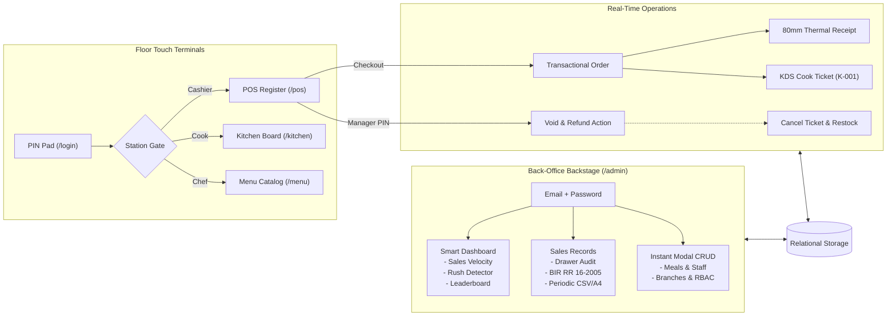

<div align="center">

# EASYPOS
### Enterprise Multi-Branch Point of Sale, Kitchen Display & Business Intelligence

[](https://laravel.com)
[](https://livewire.laravel.com)
[](https://filamentphp.com)
[](https://tailwindcss.com)
[](https://php.net)
[](tests/)
[](https://www.bir.gov.ph)
[](LICENSE)

<br/>

<p align="center">
  A domain-driven point-of-sale and kitchen ecosystem engineered for multi-unit food and retail chains.<br/>
  Combines a zero-latency touch terminal with an executive back-office command center.
</p>

<p align="center">
  <a href="#quick-start"><b>Quick Start</b></a> -
  <a href="#system-capabilities"><b>System Capabilities</b></a> -
  <a href="#architecture--data-flow"><b>Architecture</b></a> -
  <a href="#station-routing--rbac"><b>Station Routing</b></a> -
  <a href="#seeded-credentials"><b>Credentials</b></a> -
  <a href="#automated-testing"><b>Automated Testing</b></a>
</p>

</div>

---

<details>
<summary><b>Table of Contents</b></summary>

<br/>

<table width="100%">
  <tbody>
    <tr>
      <td width="50%" valign="top">
        <b>Core Architecture & Getting Started</b>
        <ul>
          <li><a href="#system-capabilities">System Capabilities</a>
            <ul>
              <li>Point of Sale (POS) & Void Engine</li>
              <li>Kitchen Display System (KDS)</li>
              <li>Sales Intelligence & BIR RR 16-2005</li>
              <li>Catalog & Portion Management</li>
              <li>Multi-Branch Governance</li>
              <li>Security & Performance</li>
            </ul>
          </li>
          <li><a href="#quick-start">Quick Start & Local Setup</a></li>
          <li><a href="#seeded-credentials">Seeded Credentials & Test Accounts</a></li>
        </ul>
      </td>
      <td width="50%" valign="top">
        <b>Engineering & Specifications</b>
        <ul>
          <li><a href="#architecture--data-flow">Architecture & Data Flow Diagram</a></li>
          <li><a href="#station-routing--rbac">Station Routing & Role-Based Access Control</a></li>
          <li><a href="#automated-testing">Automated Testing & 16-Suite Coverage Matrix</a></li>
          <li><a href="#repository-structure">Repository Structure (Modular Monolith)</a></li>
          <li><a href="#thermal--print-specifications">Thermal & Print Specifications (80mm & A4)</a></li>
          <li><a href="#license">License</a></li>
        </ul>
      </td>
    </tr>
  </tbody>
</table>

</details>

---

## System Capabilities

<table width="100%">
  <thead>
    <tr>
      <th width="33%" align="left">Point of Sale (POS)</th>
      <th width="33%" align="left">Kitchen Display System (KDS)</th>
      <th width="33%" align="left">Sales Intelligence & BIR Tax</th>
    </tr>
  </thead>
  <tbody>
    <tr>
      <td valign="top">
        <ul>
          <li><b>Alpine.js Cart</b>: 0ms real-time search & quantity updates.</li>
          <li><b>Multi-Tender</b>: Cash, Credit/Debit, and QR Ph transfers.</li>
          <li><b>Manager Void Gate</b>: Transactional rollback with manager PIN approval.</li>
          <li><b>80mm Receipts</b>: BIR-compliant thermal print layout.</li>
        </ul>
      </td>
      <td valign="top">
        <ul>
          <li><b>Sequential Queue</b>: Real-time ticket lifecycle (<code>new</code> &rarr; <code>served</code>).</li>
          <li><b>Line-Item Checkoffs</b>: Plate-by-plate prep completion.</li>
          <li><b>Rush Prioritization</b>: Visual tags & audible runner alerts.</li>
          <li><b>Recall Grace Window</b>: Instantly undo accidental ticket bumps.</li>
        </ul>
      </td>
      <td valign="top">
        <ul>
          <li><b>Executive Dashboard</b>: Live revenue velocity & sales totals.</li>
          <li><b>Peak Rush Detector</b>: Automatic Lunch & Dinner rush heuristics.</li>
          <li><b>BIR RR 16-2005</b>: Statutory 12% VAT calculations.</li>
          <li><b>Audit Reports</b>: Cash register balancing & printable A4 sheets.</li>
        </ul>
      </td>
    </tr>
    <tr>
      <th align="left">Catalog & Recipe Management</th>
      <th align="left">Multi-Branch Governance</th>
      <th align="left">Security & Performance</th>
    </tr>
    <tr>
      <td valign="top">
        <ul>
          <li><b>Non-Blocking Loaders</b>: Scoped spinners during code generation.</li>
          <li><b>Auto Code Engine</b>: Formats menu items (e.g. <code>BUR-001</code>).</li>
          <li><b>86'd Quick-Toggle</b>: Real-time out-of-stock floor sync.</li>
          <li><b>Portion Countdown</b>: Daily limited portion countdowns.</li>
        </ul>
      </td>
      <td valign="top">
        <ul>
          <li><b>Data Scoping</b>: Segregate menus & staff per location.</li>
          <li><b>Instant Modal CRUD</b>: Zero full-page navigations in back office.</li>
          <li><b>Branch Code Generator</b>: Auto-formats acronyms (e.g. <code>DOFL</code>).</li>
          <li><b>Centralized Auditing</b>: Global order ledger & receipt reprints.</li>
        </ul>
      </td>
      <td valign="top">
        <ul>
          <li><b>Dual-Persona Gate</b>: Floor PIN vs. Back-Office Password.</li>
          <li><b>Terminal Page Lock</b>: Traps browser back navigation on terminals.</li>
          <li><b>Zero Layout Shift</b>: Fixed-dimension loaders prevent UI jumping.</li>
          <li><b>Filament SPA Engine</b>: View prefetching with eager-loaded relations.</li>
        </ul>
      </td>
    </tr>
  </tbody>
</table>

---

## Quick Start

```powershell
# 1. Clone repository and install dependencies
git clone <repository-url> EASYPOS
cd EASYPOS
composer install
npm install

# 2. Configure environment and seed relational database
cp .env.example .env
php artisan key:generate
php artisan migrate:fresh --seed

# 3. Build assets and launch local server
npm run build
php artisan serve
```

> [!NOTE]
> **Station Endpoints**:
> - Floor Staff Terminal: [`http://localhost:8000/login`](http://localhost:8000/login)
> - Administrative Command Center: [`http://localhost:8000/admin`](http://localhost:8000/admin)

---

## Seeded Credentials

Pre-configured accounts loaded by `DatabaseSeeder`:

### Floor Staff Touch Terminals (`/login`)
Staff sign in using **Employee ID + 4-Digit PIN** (or use the on-screen 1-click test shortcut):

<table width="100%">
  <thead>
    <tr>
      <th align="left">Station</th>
      <th align="left">Role</th>
      <th align="left">Employee ID</th>
      <th align="center">PIN</th>
      <th align="left">Default Landing Route</th>
    </tr>
  </thead>
  <tbody>
    <tr>
      <td><b>POS Register</b></td>
      <td>Cashier</td>
      <td><code>B01-CSH-001</code></td>
      <td align="center"><kbd>1234</kbd></td>
      <td><a href="http://localhost:8000/pos"><code>/pos</code></a></td>
    </tr>
    <tr>
      <td><b>Chef Station</b></td>
      <td>Chef</td>
      <td><code>B01-CHF-001</code></td>
      <td align="center"><kbd>2345</kbd></td>
      <td><a href="http://localhost:8000/menu"><code>/menu</code></a></td>
    </tr>
    <tr>
      <td><b>Kitchen Display</b></td>
      <td>Cook</td>
      <td><code>B01-COK-001</code></td>
      <td align="center"><kbd>3456</kbd></td>
      <td><a href="http://localhost:8000/kitchen"><code>/kitchen</code></a></td>
    </tr>
    <tr>
      <td><b>Floor Void Gate</b></td>
      <td>Branch Manager</td>
      <td><code>B01-MGR-001</code></td>
      <td align="center"><kbd>9999</kbd></td>
      <td><a href="http://localhost:8000/pos"><code>/pos</code></a> (Manager Approval)</td>
    </tr>
  </tbody>
</table>

### Back-Office Administrative Portal (`/admin/login`)
Staff sign in using **Email + Password**:

<table width="100%">
  <thead>
    <tr>
      <th align="left">Access Level</th>
      <th align="left">User Name</th>
      <th align="left">Email Address</th>
      <th align="center">Password</th>
      <th align="left">Data Scope</th>
    </tr>
  </thead>
  <tbody>
    <tr>
      <td><b>Super Admin</b></td>
      <td>System Owner</td>
      <td><code>owner@easypos.com</code></td>
      <td align="center"><kbd>password</kbd></td>
      <td>Global (All Locations)</td>
    </tr>
    <tr>
      <td><b>Store Manager</b></td>
      <td>Branch Manager</td>
      <td><code>mgr-b01@easypos.com</code></td>
      <td align="center"><kbd>password</kbd></td>
      <td>Branch 01 Scoped</td>
    </tr>
  </tbody>
</table>

---

## Architecture & Data Flow



---

## Station Routing & RBAC

Staff members are locked to their assigned stations upon authentication. Unauthorized access attempts trigger an immediate `403 Forbidden`:

<table width="100%">
  <thead>
    <tr>
      <th align="left">Source Route</th>
      <th align="left">Authentication Factor</th>
      <th align="left">Destination Station</th>
      <th align="left">Granted Capabilities</th>
    </tr>
  </thead>
  <tbody>
    <tr>
      <td><code>/login</code></td>
      <td>Cashier PIN (4 digits)</td>
      <td><code>/pos</code></td>
      <td>Take orders, apply discounts, process payments, view progress</td>
    </tr>
    <tr>
      <td><code>/login</code></td>
      <td>Cook PIN (4 digits)</td>
      <td><code>/kitchen</code></td>
      <td>Claim tickets, check off dishes, bump orders, recall tickets</td>
    </tr>
    <tr>
      <td><code>/login</code></td>
      <td>Chef PIN (4 digits)</td>
      <td><code>/menu</code></td>
      <td>Toggle 86'd status, configure daily portions, edit dishes</td>
    </tr>
    <tr>
      <td><code>/login</code></td>
      <td>Manager PIN (4 digits)</td>
      <td><code>/pos</code></td>
      <td>Authorize order voids, refunds, and terminal audits</td>
    </tr>
    <tr>
      <td><code>/admin/login</code></td>
      <td>Email & Password</td>
      <td><code>/admin</code></td>
      <td>Access executive analytics, ledger, tax compliance, and system settings</td>
    </tr>
  </tbody>
</table>

> [!NOTE]
> **Terminal Lock**: Active floor screens feature history trapping (`page-lock.js`) that prevents accidental browser back navigation during live shifts.

---

## Automated Testing

EASYPOS includes **16 test suites** executed via PHPUnit:

```powershell
php vendor/bin/phpunit --do-not-cache-result
```

<details open>
<summary><b>Test Suite Matrix (137 Tests / 552 Assertions &mdash; 100% Passed)</b></summary>

<br/>

<table width="100%">
  <thead>
    <tr>
      <th align="left">Suite</th>
      <th align="center">Type</th>
      <th align="center">Tests</th>
      <th align="center">Assertions</th>
      <th align="left">Coverage Focus</th>
    </tr>
  </thead>
  <tbody>
    <tr>
      <td><code>Sprint3AnalyticsTest.php</code></td>
      <td align="center">Feature</td>
      <td align="center">4</td>
      <td align="center">79</td>
      <td>Volume/revenue ranking, periodic calculations, rush heuristics, A4 audit print</td>
    </tr>
    <tr>
      <td><code>PointOfSaleTest.php</code></td>
      <td align="center">Feature</td>
      <td align="center">17</td>
      <td align="center">62</td>
      <td>Cart calculation, multi-tender change, portion decrement, BIR accessors</td>
    </tr>
    <tr>
      <td><code>MenuDatabaseTest.php</code></td>
      <td align="center">Feature</td>
      <td align="center">15</td>
      <td align="center">66</td>
      <td>Meal CRUD domain actions, availability toggles, non-blocking code generation</td>
    </tr>
    <tr>
      <td><code>OrderProgressTest.php</code></td>
      <td align="center">Feature</td>
      <td align="center">11</td>
      <td align="center">44</td>
      <td>Slide-over drawer, lifecycle filtering, read-only cashier tracking, status pills</td>
    </tr>
    <tr>
      <td><code>UserManagementTest.php</code></td>
      <td align="center">Feature</td>
      <td align="center">13</td>
      <td align="center">43</td>
      <td>Back-office staff onboarding, PIN hashing, branch scoping, active status toggle</td>
    </tr>
    <tr>
      <td><code>AuthTest.php</code></td>
      <td align="center">Feature</td>
      <td align="center">10</td>
      <td align="center">42</td>
      <td>Floor staff PIN keypad, auto-submit logic, rate-limit lockouts, station redirects</td>
    </tr>
    <tr>
      <td><code>CodeGeneratorAndEnumsTest.php</code></td>
      <td align="center">Unit</td>
      <td align="center">5</td>
      <td align="center">37</td>
      <td>SystemConstants, enum labels, auto-code generators, reactive modal binding</td>
    </tr>
    <tr>
      <td><code>SalesRecordsTest.php</code></td>
      <td align="center">Feature</td>
      <td align="center">7</td>
      <td align="center">36</td>
      <td>Drawer balancing, BIR RR 16-2005 tax calculations, CSV export streams</td>
    </tr>
    <tr>
      <td><code>KitchenTest.php</code></td>
      <td align="center">Feature</td>
      <td align="center">10</td>
      <td align="center">35</td>
      <td>Cook ticket claiming, plate checkoffs, bumps, ticket recalls, rush tags</td>
    </tr>
    <tr>
      <td><code>AuthorizationTest.php</code></td>
      <td align="center">Feature</td>
      <td align="center">17</td>
      <td align="center">35</td>
      <td>Station routing, 403 enforcement, root redirection, navbar badge visibility</td>
    </tr>
    <tr>
      <td><code>ErrorPagesTest.php</code></td>
      <td align="center">Feature</td>
      <td align="center">10</td>
      <td align="center">34</td>
      <td>Custom error views (401, 403, 404, 419, 429, 500, 503)</td>
    </tr>
    <tr>
      <td><code>VoidOrderTest.php</code></td>
      <td align="center">Feature</td>
      <td align="center">5</td>
      <td align="center">16</td>
      <td>Transactional void execution, manager approval PIN, payment refunds, restock</td>
    </tr>
    <tr>
      <td><code>TransactionHistoryTest.php</code></td>
      <td align="center">Feature</td>
      <td align="center">4</td>
      <td align="center">12</td>
      <td>Historical order audit, branch scoping, receipt modal inspection</td>
    </tr>
    <tr>
      <td><code>FilamentPanelTest.php</code></td>
      <td align="center">Feature</td>
      <td align="center">7</td>
      <td align="center">9</td>
      <td>Admin authentication gates, panel access control, session isolation</td>
    </tr>
    <tr>
      <td><code>ExampleTest.php</code> (Feature)</td>
      <td align="center">Feature</td>
      <td align="center">1</td>
      <td align="center">1</td>
      <td>Feature baseline verification</td>
    </tr>
    <tr>
      <td><code>ExampleTest.php</code> (Unit)</td>
      <td align="center">Unit</td>
      <td align="center">1</td>
      <td align="center">1</td>
      <td>Unit baseline verification</td>
    </tr>
    <tr>
      <td><b>Total (16 Suites)</b></td>
      <td align="center"><b>All</b></td>
      <td align="center"><b>137</b></td>
      <td align="center"><b>552</b></td>
      <td><b>100% Passing (0 Failures, 0 Errors)</b></td>
    </tr>
  </tbody>
</table>

</details>

---

## Repository Structure

<details>
<summary><b>Directory Tree</b></summary>

<br/>

```text
EASYPOS/
├── app/
│   ├── Domains/                                      # Modular Monolith Domains
│   │   ├── Branches/                                 # Multi-Branch Models & Scoping
│   │   ├── Identity/                                 # PIN Auth, Staff RBAC & Models
│   │   ├── Kitchen/                                  # KDS Livewire & Ticket Lifecycle
│   │   ├── Menu/                                     # Dishes, Categories & Availability
│   │   └── PointOfSale/                              # Checkout, Orders, Voids & Analytics
│   ├── Filament/                                     # Back-Office Admin Portal (/admin)
│   │   ├── Pages/Dashboard.php                       # Smart BI Sales Dashboard
│   │   ├── Pages/SalesRecords.php                    # Financial Ledger & BIR Auditing
│   │   ├── Resources/                                # Instant Modal CRUD Resources
│   │   └── Widgets/                                  # Revenue & Hourly Rush Charts
│   └── Support/                                      # Centralized Enterprise Support
│       ├── Constants/SystemConstants.php             # Statutory rates, currency & sizes
│       ├── Enums/                                    # Type-safe PHP 8.2 Backed Enums
│       └── Services/CodeGeneratorService.php         # Emp ID, Menu Code & Branch Code gen
├── resources/
│   ├── css/app.css                                   # Tailwind CSS v4 design tokens
│   ├── js/components/pin-pad.js                      # Zero-lag Alpine PIN pad
│   └── views/
│       ├── components/pos/receipt-slip.blade.php     # 80mm BIR thermal receipt print
│       ├── filament/pages/                           # Admin Dashboard & Ledger views
│       ├── livewire/menu/partials/                   # Scoped non-blocking dish modal
│       └── reports/periodic-sales-audit.blade.php    # A4 printable tax audit report
└── tests/                                            # 16 Feature & Unit Test Suites
```

</details>

---

## Thermal & Print Specifications

<table width="100%">
  <thead>
    <tr>
      <th width="50%" align="left">80mm Thermal Receipt (POS)</th>
      <th width="50%" align="left">A4 Periodic BIR Tax Audit Sheet</th>
    </tr>
  </thead>
  <tbody>
    <tr>
      <td valign="top">
        <ul>
          <li><b>Target View</b>: <code>components/pos/receipt-slip.blade.php</code></li>
          <li><b>Dimensions</b>: 72mm printable width on standard 80mm roll.</li>
          <li><b>Compliance</b>: Store TIN, MIN, POS Machine Serial No., Cashier ID.</li>
          <li><b>Exemptions</b>: Senior Citizen / PWD ID acknowledgment lines.</li>
        </ul>
      </td>
      <td valign="top">
        <ul>
          <li><b>Target View</b>: <code>reports/periodic-sales-audit.blade.php</code></li>
          <li><b>Dimensions</b>: Standard A4 portrait margins (<code>12mm 10mm 12mm 10mm</code>).</li>
          <li><b>Regulations</b>: BIR Revenue Regulation RR 16-2005 tax schedule.</li>
          <li><b>Ledger</b>: Vatable Sales, 12% Output VAT, VAT-Exempt, Net Tax Due.</li>
        </ul>
      </td>
    </tr>
  </tbody>
</table>

---

## License

EASYPOS is open-sourced software licensed under the [MIT license](LICENSE).
